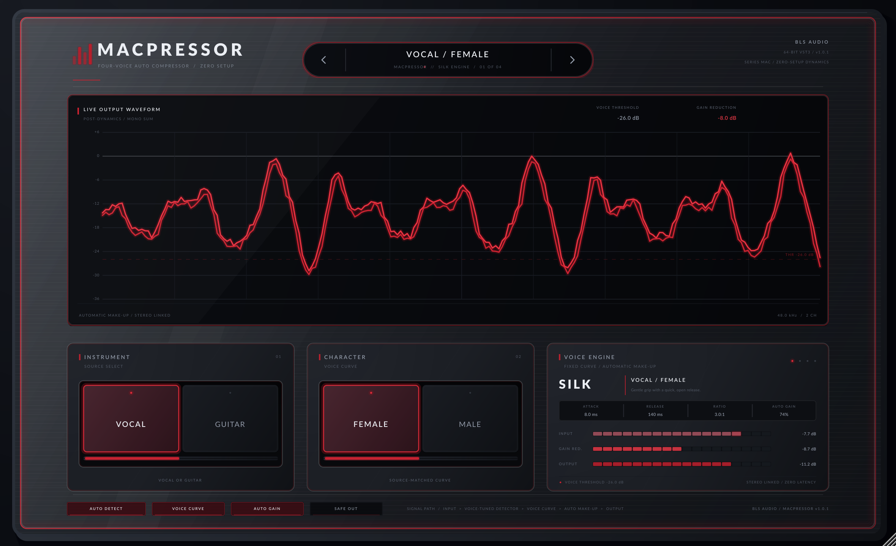

# MacPressor



**Four voices. Two switches. No knobs.**

MacPressor is a JUCE 8 / VST3 automatic compressor built around a deliberately
minimal interface. There is no threshold, ratio, attack or release to set. Pick
the source and the character; the compressor loads a fixed, source-matched
curve and tracks the gain reduction with automatic make-up gain.

## Controls

| Switch | Position | Voice |
| :--- | :--- | :--- |
| **Instrument** | Vocal | Vocal female / male curves |
| | Guitar | Guitar clean / overdrive curves |
| **Character** | Vocal | **Female** or **Male** |
| | Guitar | **Clean** or **Overdrive** |

The header `<` `>` chevrons and the four-position voice rail are shortcuts for
the same single `Voice` parameter exposed to the host. There are no other
plugin parameters. VST3 hosts may also display the standard VST3 **Bypass**
parameter, which is required by the format and is not part of MacPressor's
interface.

### Scope status

The live scope also reports what the host is doing, which is the quickest way
to tell a routing problem from a broken compressor:

| Footer text | Meaning |
| :--- | :--- |
| `48.0 kHz / 2 CH` | Audio is arriving and being processed. |
| `AWAITING HOST AUDIO` | No block has reached the plug-in yet (transport stopped, or the host is not calling `processBlock`). |
| `NO INPUT SIGNAL / CHECK ROUTING` | Blocks are arriving but they are silent; check the track input, the bus layout, or an upstream mute/solo. |
| `HOST BYPASS / DRY` | The host has the unit bypassed, so the audio is dry by design. Re-enable the plug-in in the host's mixer. |

## Voice design

Each voice has its own fixed detection high-pass, soft-knee threshold, ratio,
attack/release ballistics, parallel blend and automatic make-up law:

| Voice | Attack | Release | Ratio | Character |
| :--- | ---: | ---: | ---: | :--- |
| Vocal / Female | 8 ms | 140 ms | 3.0:1 | gentle grip, open release |
| Vocal / Male | 13 ms | 180 ms | 3.3:1 | firmer grip, steady body |
| Guitar / Clean | 24 ms | 240 ms | 2.4:1 | pick attack preserved |
| Guitar / Overdrive | 4 ms | 95 ms | 4.0:1 | fast, tight leveling |

A stereo-linked detector keeps the image locked. Make-up gain follows the
gain-reduction envelope so switching voices or source levels stays musical.
A gentle output safety stage catches overs without acting like a second
limiter.

## Install

Build outputs live in `dist/`:

- `MacPressor.vst3` — copy to your VST3 folder (`~/.vst3` on Linux/macOS,
  `C:\Program Files\Common Files\VST3` on Windows).
- `MacPressor` / `MacPressor.exe` / `MacPressor.app` — standalone host.

## Build (Linux)

The project reuses the local JUCE 8.0.8 and sysroot caches when present:

```bash
./scripts/setup-linux.sh
./scripts/build.sh
```

The build produces the VST3, Standalone, DSP tests, processor tests, VST3 host
smoke test and headless screenshot renderer. The script follows the local
sysroot layout from `../plugin_poc` so the build works offline.

## Tests

```bash
./build/MacPressorTests_artefacts/Release/MacPressorTests
./build/MacPressorProcessorTests_artefacts/Release/MacPressorProcessorTests
./build/MacPressorHostSmokeTest_artefacts/Release/MacPressorHostSmokeTest \
  dist/MacPressor.vst3
```

The DSP tests cover the compressor curve itself. The processor tests drive
`processBlock` the way hosts do: stereo and mono buffers, a mono `prepareToPlay`
followed by stereo blocks (a Windows host pattern that used to mute a channel),
full-ring and zero-length blocks, host bypass, and the waveform telemetry the
scope reads. The host test additionally verifies that the VST3 exposes exactly
one parameter, that all four voices process audio, that latency is zero, that
the wrapper path actually reduces peaks, and that state round-trips.

Render a UI preview (the renderer also verifies that the scope contains a live
waveform and exits non-zero if it is blank):

```bash
xvfb-run -a ./build/MacPressorScreenshot_artefacts/Release/MacPressorScreenshot \
  --out=dist/macpressor-ui.png
```

## Visual language

Brushed gunmetal chassis, flush screwless glass overlay, muted crimson LED
edge-glow, a central obsidian live-waveform scope, and two low-profile
machined source switches. No visible fasteners.

## CI / releases

`.github/workflows/build.yml` builds Windows x64, Linux x64 and a macOS
Universal binary, runs the DSP, processor and VST3 host tests, renders and
verifies the waveform UI on Linux and Windows, and packages `.zip` + `.sha256`
artifacts. Pushing a `v*` tag (or running the workflow manually with a release
tag) publishes a GitHub Release.

## License

MacPressor source is provided under the MIT license. The bundled Lato fonts
are distributed under the SIL Open Font License; see `Resources/Lato-OFL.txt`.
